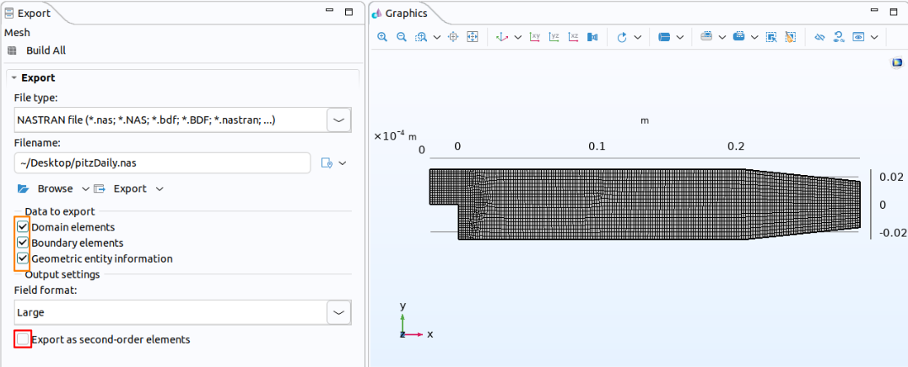
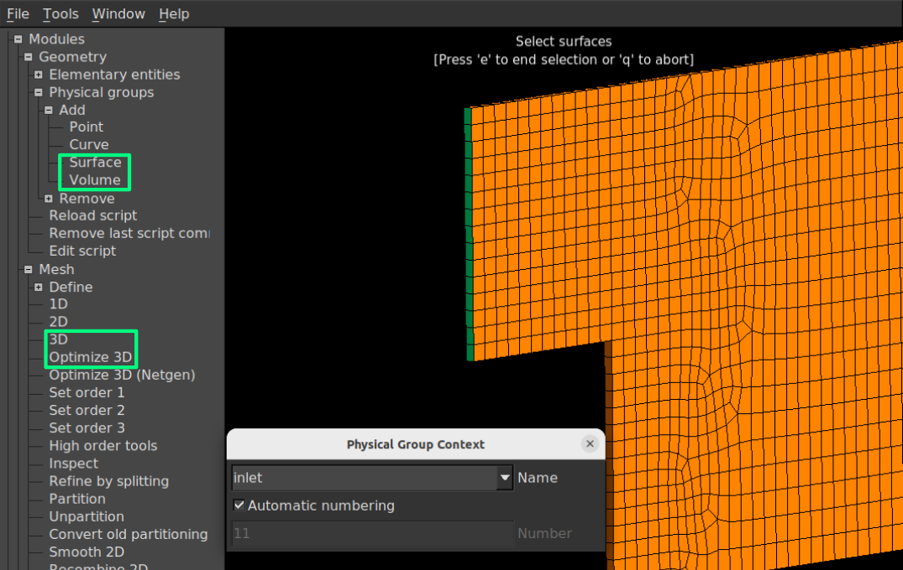

Use COMSOL Multiphysics mesh in OpenFOAM for CFD simulations. This tutorial introduces the export and conversion workflow.

<style>
.cmf-card{border:1px solid #d0d7de;border-radius:12px;padding:1rem 1.2rem;margin:1.4rem 0;background:#f8fafc;color:#1f2933;box-shadow:0 1px 3px rgba(0,0,0,.06)}
.cmf-card h4{margin:0 0 .5rem;font-size:1.05em;color:#1f2933}
.cmf-card p{margin:.4rem 0;color:#1f2933}
.cmf-card code,.cmf-callout code{background:rgba(110,118,129,.18);color:inherit;padding:.05em .35em;border-radius:5px}
.cmf-muted{color:#52606d !important;font-size:.92em}
.cmf-automation-title{margin-top:3.2em;padding-top:1.1em;border-top:2px solid #98C326;font-size:1.45em;line-height:1.3;letter-spacing:-.02em}
.cmf-callout{border-left:4px solid #2f81f7;background:#eef5ff;color:#1f2933;padding:.7rem 1rem;border-radius:0 8px 8px 0;margin:1.2rem 0}
.cmf-callout p,.cmf-callout ul{margin:.3rem 0;color:#1f2933}
.cmf-callout.warn{border-left-color:#d29922;background:#fff8e6}
.cmf-callout.good{border-left-color:#2da44e;background:#eafaf0}
.cmf-steps{display:flex;flex-wrap:wrap;gap:.7rem;margin:1.2rem 0}
.cmf-step{flex:1 1 150px;display:block;padding:.8rem 1rem;border:1px solid #d0d7de;border-radius:12px;background:#fff;color:#1f2933 !important;text-decoration:none !important;transition:transform .15s,box-shadow .15s}
.cmf-step:hover{transform:translateY(-3px);box-shadow:0 6px 14px rgba(0,0,0,.14)}
.cmf-step b{display:block;font-size:1.05em;margin-top:.2rem}
.cmf-step small{display:block;color:#52606d;line-height:1.3;margin-top:.15rem}
.cmf-num{display:inline-block;width:1.7em;height:1.7em;line-height:1.7em;text-align:center;border-radius:50%;background:#2f81f7;color:#fff;font-weight:700}
.cmf-row{display:flex;gap:.7rem;align-items:flex-start;padding:.55rem .6rem;margin:.3rem 0;border-radius:8px;border:1px solid transparent;cursor:pointer;background:#fff}
.cmf-row input{margin-top:.35rem;transform:scale(1.2)}
.cmf-row span{flex:1}
.cmf-row b {
  color: #263238 !important;
}
.cmf-row small{display:block;color:#52606d;line-height:1.35}
.cmf-row.ok{border-color:#2da44e;background:#f1fbf4}
.cmf-row.bad{border-color:#e5b8b5;background:#fff}
.cmf-badge{font-style:normal;font-weight:700;width:1.5em;text-align:center}
.cmf-row.ok .cmf-badge{color:#1a7f37}
.cmf-row.bad .cmf-badge{color:#cf222e}
.cmf-status{margin-top:.7rem;padding:.55rem .8rem;border-radius:8px;font-weight:600}
.cmf-status.warn{background:#fff8e6;color:#7a5a00}
.cmf-status.good{background:#eafaf0;color:#17602b}
.cmf-seg{display:inline-flex;border:1px solid #2f81f7;border-radius:999px;overflow:hidden;margin:.2rem 0 .8rem}
.cmf-seg button{border:0;background:#fff;color:#2f81f7;padding:.4rem 1rem;cursor:pointer;font-weight:600}
.cmf-seg button.on{background:#2f81f7;color:#fff}
.cmf-order-body{display:flex;flex-wrap:wrap;gap:1rem;align-items:center}
.cmf-order-body svg{flex:0 1 280px;background:#fff;border-radius:10px;border:1px solid #e1e4e8}
.cmf-order-side{flex:1 1 260px}
.cmf-order table{border-collapse:collapse;width:100%;font-size:.92em;background:#fff;color:#1f2933}
.cmf-order th,.cmf-order td{border:1px solid #e1e4e8;padding:.3rem .6rem;text-align:left;color:#1f2933}
.cmf-order th{background:#f1f3f5}
.cmf-o2g{display:none}
#cmf-order[data-order="2"] .cmf-o2g{display:inline}
#cmf-order[data-order="2"] .cmf-o1g{display:none}
#cmf-order[data-order="1"] .c1,#cmf-order[data-order="2"] .c2{background:#e8f0fe;font-weight:700}
.cmf-m1,.cmf-m2{display:none;padding:.5rem .7rem;border-radius:8px;margin-top:.7rem}
#cmf-order[data-order="1"] .cmf-m1{display:block;background:#eafaf0;color:#17602b}
#cmf-order[data-order="2"] .cmf-m2{display:block;background:#fff8e6;color:#7a5a00}
.cmf-pick{display:flex;flex-wrap:wrap;gap:.5rem;margin:.4rem 0 .8rem}
.cmf-pick button,.cmf-form button,.cmf-term-bar button{border:1px solid #2f81f7;background:#fff;color:#2f81f7;padding:.35rem .9rem;border-radius:8px;cursor:pointer;font-weight:600}
.cmf-pick button.on,.cmf-form button.main,.cmf-term-bar button.main{background:#2f81f7;color:#fff}
.cmf-form button.alt{border-color:#8c959f;color:#57606a}
.cmf-code{background:#0d1117 !important;color:#e6edf3 !important;padding:.8rem 1rem !important;border-radius:8px;overflow:auto;white-space:pre;margin:.5rem 0;font-size:.9em;line-height:1.45}
.cmf-chips{display:grid;grid-template-columns:repeat(auto-fill,minmax(105px,1fr));gap:.5rem;margin:.6rem 0}
.cmf-chip{padding:.45rem .6rem;border-radius:10px;background:#e5e7eb;color:#1f2933;border:2px solid transparent;text-align:center;transition:background .2s,transform .2s}
.cmf-chip b{display:block;font-size:1.1em}
.cmf-chip small{display:block;font-size:.8em;word-break:break-all}
.cmf-chip.on{transform:scale(1.04)}
.cmf-form{display:flex;flex-wrap:wrap;gap:.5rem;margin:.6rem 0}
.cmf-form input{flex:1 1 150px;padding:.4rem .6rem;border:1px solid #8c959f;border-radius:8px;background:#fff;color:#1f2933}
.cmf-msg{min-height:1.5em;margin:.4rem 0;font-weight:600}
.cmf-msg.bad{color:#cf222e}
.cmf-msg.good{color:#1a7f37}
.cmf-msg.warn{color:#9a6700}
.cmf-term{background:#0d1117 !important;color:#e6edf3 !important;padding:.8rem 1rem !important;border-radius:8px;max-height:24rem;overflow:auto;white-space:pre;font-size:.82em;line-height:1.4;margin:.5rem 0}
.t-g{color:#3fb950}
.t-o{color:#e3b341}
.t-r{color:#f85149}
.t-y{color:#8b949e}
.t-c{color:#79c0ff}
.cmf-term-bar{display:flex;flex-wrap:wrap;gap:.5rem;align-items:center}
.cmf-term-note{margin:.3rem 0;color:#1f2933}
.cmf-copy{position:absolute;top:.4rem;right:.4rem;font-size:.75em;padding:.15rem .55rem;border:1px solid #8c959f;border-radius:6px;background:rgba(255,255,255,.92);color:#1f2933;cursor:pointer;opacity:.85}
.cmf-copy:hover{opacity:1}
details.cmf-faq{border:1px solid #d0d7de;border-radius:10px;margin:.6rem 0;background:#f8fafc;color:#1f2933}
details.cmf-faq summary{cursor:pointer;padding:.6rem .9rem;font-weight:600;color:#1f2933}
details.cmf-faq div{padding:0 .9rem .7rem;color:#1f2933}
details.cmf-faq code{background:rgba(110,118,129,.18);color:inherit;padding:.05em .35em;border-radius:5px}

/* Start the callouts below the TOC */
.page__content > .cmf-callout {
  clear: both;
}

</style>



You have a good mesh in COMSOL. Getting it into OpenFOAM takes a few specific export (**COMSOL**), conversion (**Gmsh**), and import (**OpenFOAM**) settings. This post walks through the settings and the conversion that works, there are a few widgets to try with along the way. At the end a link to Python script for automating the Gmsh conversion step is provided.


<div class="cmf-callout good">
<p><b>TL;DR</b> Export a Nastran <code>.nas</code> file (domain elements, boundary elements, geometric entity information, <b>first order</b>) &rarr; name surfaces and volumes in Gmsh &rarr; save as MSH version 2 ASCII &rarr; <code>gmshToFoam</code> &rarr; <code>checkMesh</code>. Skip the GUI clicking with the <a href="#automate">script at the end</a>.</p>
</div>

<div class="cmf-callout">
<p><b>Before you start.</b> This tutorial assumes you are comfortable with:</p>
<ul><li>creating geometry and generating meshes in COMSOL,</li><li>the basic structure of an OpenFOAM case,</li><li>running OpenFOAM utilities from the terminal.</li></ul>
<p>The focus is on moving the mesh between the two environments, not on meshing technique or on setting up a complete CFD simulation.</p>
</div>

# Overview

OpenFOAM (OF) offers a flexible framework and a wide range of solvers for computational fluid dynamics (CFD). However, preparing geometry, generating a mesh, and configuring a case can take considerable effort particularly when a study requires repeated geometry changes. On the other hand, COMSOL mutliphysics combines integrated CAD design and mesh generation modules with the mutliphysics solvers. For users already working in COMSOL, this offers a convenient way to modify a CAD geometry and regenerate mesh without maintaining a separate geometry and meshing workflow. Moreover, COMSOL is equipped with an automatic mesh generation engine which can generate mesh and facilitates process such as face and boundary layer mesh generation. 

Combining the two gives COMSOL users access to OpenFOAM's dedicated CFD solvers, and gives OpenFOAM users a fast geometry and mesh modification platform. A good quality COMSOL mesh will usually pass the OpenFOAM `checkMesh` requirements, therefore the mesh generated by COMSOL can be used in OpenFOAM solvers, which is what makes this combination practical.

# Workflow at a glance

The conversion has four steps. Each has a few details that matter, discussed below. Click a card to jump to it.

<div class="cmf-steps">
<a class="cmf-step" href="#export"><span class="cmf-num">1</span><b>Export</b><small>Nastran file from COMSOL, with volume and boundary elements</small></a>
<a class="cmf-step" href="#convert"><span class="cmf-num">2</span><b>Convert</b><small>Gmsh MSH 2.2, first-order elements, named physical groups</small></a>
<a class="cmf-step" href="#import"><span class="cmf-num">3</span><b>Import</b><small><code>gmshToFoam</code> creates the OpenFOAM mesh</small></a>
<a class="cmf-step" href="#check"><span class="cmf-num">4</span><b>Check</b><small>Run <code>checkMesh</code>, set patch types and boundary conditions</small></a>
</div>

<div class="cmf-callout warn">
<p><b>Heads-up.</b> A successful conversion does not, by itself, show that the mesh is suitable for simulation. Before proceeding, run <code>checkMesh</code> and review the imported mesh in ParaView.</p>
</div>

## 1. Exporting the mesh from COMSOL {#export}

Once mesh generation is complete in COMSOL, right-click the **Mesh** node and select **Export**. Choose Nastran (`.nas`) as the file type. Figure 1 shows the export settings for the `pitzDaily` tutorial mesh generated in COMSOL.



*Figure 1. COMSOL export settings for the `pitzDaily` mesh, showing the Nastran file type, selected data, and second-order element option.*

In the **Data to export** section, select **domain elements**, **boundary elements** and **geometric entity information**. The last one stores the surface or volume number of every element in the file, which is what lets you identify surfaces and volumes and assign them to physical groups in Gmsh. Finally, uncheck **Export as second-order elements**, so that the file contains first-order elements for the `gmshToFoam` conversion. Once everything is set, export the `.nas` file. It is ready for the Gmsh session.


> **Note**: check the boxes below and the checklist shows whether the file will work.

<div class="cmf-card" id="cmf-check">
<h4>Are your export settings correct?</h4>
<label class="cmf-row"><input type="checkbox" data-want="1"><span><b>Domain elements</b><small>The 3D cells. Without them there is nothing to build an OpenFOAM mesh from.</small></span><em class="cmf-badge"></em></label>
<label class="cmf-row"><input type="checkbox" data-want="1"><span><b>Boundary elements</b><small>The surface elements. Without them there is nothing to name as patches.</small></span><em class="cmf-badge"></em></label>
<label class="cmf-row"><input type="checkbox" data-want="1"><span><b>Geometric entity information</b><small>Writes the surface or volume number of each element into the file, so Gmsh can tell them apart.</small></span><em class="cmf-badge"></em></label>
<label class="cmf-row"><input type="checkbox" data-want="0" checked><span><b>Export as second-order elements</b><small>Must be off: gmshToFoam only reads first-order elements.</small></span><em class="cmf-badge"></em></label>
<div class="cmf-status" aria-live="polite"></div>
</div>
<script>
(function(){
var root=document.getElementById('cmf-check');if(!root)return;
var boxes=root.querySelectorAll('input[type=checkbox]');
var status=root.querySelector('.cmf-status');
function update(){
var wrong=0;
Array.prototype.forEach.call(boxes,function(b){
var want=b.getAttribute('data-want')==='1';
var ok=b.checked===want;
if(!ok)wrong++;
var row=b.parentNode;
row.classList.toggle('ok',ok);row.classList.toggle('bad',!ok);
row.querySelector('.cmf-badge').textContent=ok?'\u2713':'\u2717';
});
status.className='cmf-status '+(wrong?'warn':'good');
status.textContent=wrong?(wrong+(wrong===1?' setting still needs a change.':' settings still need a change.')):'\u2705 Ready to export. These settings give gmshToFoam what it needs.';
}
Array.prototype.forEach.call(boxes,function(b){b.addEventListener('change',update);});
update();
})();
</script>

Why does the second-order mesh look like? Toggle the element order to see differences.

<div class="cmf-card cmf-order" id="cmf-order" data-order="1">
<h4>First order vs. second order</h4>
<div class="cmf-seg" role="group" aria-label="Element order"><button type="button" data-o="1" class="on" aria-pressed="true">First order</button><button type="button" data-o="2" aria-pressed="false">Second order</button></div>
<div class="cmf-order-body">
<svg viewBox="0 0 280 190" role="img" aria-label="A triangular element. First order has three corner nodes, second order adds a node at the middle of every edge.">
<g class="cmf-o1g"><path d="M40,150 L240,150 L140,20 Z" fill="#dbeafe" stroke="#1f4e8c" stroke-width="3"/></g>
<g class="cmf-o2g"><path d="M40,150 Q140,174 240,150 Q209,70.4 140,20 Q71,70.4 40,150 Z" fill="#fde9c8" stroke="#b45f06" stroke-width="3"/><circle cx="140" cy="162" r="7" fill="#fff" stroke="#b45f06" stroke-width="3"/><circle cx="199.5" cy="77.7" r="7" fill="#fff" stroke="#b45f06" stroke-width="3"/><circle cx="80.5" cy="77.7" r="7" fill="#fff" stroke="#b45f06" stroke-width="3"/></g>
<g fill="#1f2933"><circle cx="40" cy="150" r="7"/><circle cx="240" cy="150" r="7"/><circle cx="140" cy="20" r="7"/></g>
</svg>
<div class="cmf-order-side">
<table>
<tr><th>Element</th><th>First order</th><th>Second order</th></tr>
<tr><td>Triangle</td><td class="c1">3 nodes</td><td class="c2">6 nodes</td></tr>
<tr><td>Tetrahedron</td><td class="c1">4 nodes</td><td class="c2">10 nodes</td></tr>
<tr><td>Prism</td><td class="c1">6 nodes</td><td class="c2">15 nodes</td></tr>
</table>
<p class="cmf-muted">Filled dots are corner nodes, open dots are the extra midside nodes. Counts for the other element shapes depend on the element family.</p>
<div class="cmf-m1">&#9989; This is what <code>gmshToFoam</code> reads. With no midside nodes, a curved edge becomes a straight line between its corners, which is negligible on a fine mesh.</div>
<div class="cmf-m2">&#9888;&#65039; <code>gmshToFoam</code> does not read these element types. It prints <code>Unhandled element</code> and skips them, so you can end up with only a fraction of your cells.</div>
</div>
</div>
</div>
<script>
(function(){
var root=document.getElementById('cmf-order');if(!root)return;
var btns=root.querySelectorAll('.cmf-seg button');
Array.prototype.forEach.call(btns,function(b){
b.addEventListener('click',function(){
var o=b.getAttribute('data-o');
root.setAttribute('data-order',o);
Array.prototype.forEach.call(btns,function(x){var on=x===b;x.classList.toggle('on',on);x.setAttribute('aria-pressed',on?'true':'false');});
});
});
})();
</script>


## 2. Converting the mesh to Gmsh {#convert}

Open the exported `.nas` file in Gmsh, then:

1. **Name the boundaries.** Go to **Geometry → Physical groups → Add** and select **Surface**. In the physical group window, name each boundary group and assign the corresponding surfaces to it. The physical-group definitions are saved in a `.geo` file. Note that surfaces left unassigned will appear under `defaultFaces` after conversion to the OpenFOAM mesh.
2. **Name the volumes.** Repeat the process with **Geometry → Physical groups → Add → Volume**, and assign a label to each domain.
3. **Mesh module.** Under **Mesh → Define**, select **3D** and, if desired, **Optimize 3D**.
4. **Export.** Go to **File → Export**, select **Mesh – Gmsh MSH** from the drop-down menu, and choose **Version 2 ASCII** in the export window.

The resulting `.msh` file can be imported into OpenFOAM with `gmshToFoam`. Figure 2 shows the Gmsh session, with the physical-group and mesh menus highlighted.



*Figure 2. Boundary selection for the `pitzDaily` mesh in Gmsh, the physical-group and mesh menus are highlighted in the sidebar.*

<div class="cmf-callout warn">
<p><b>About Optimize 3D.</b> It only works on tetrahedra and it changes the mesh you generated in COMSOL. Skip it unless you need it, and compare <code>checkMesh</code> before and after if you use it.</p>
</div>

<details class="cmf-faq"><summary>Why MSH version 2, and why ASCII?</summary><div><p>Newer Gmsh versions write MSH version 4 by default, but <code>gmshToFoam</code> expects the older version 2 ASCII format. If the converter complains about the file, check the version in the export window first.</p></div></details>

## 3. Importing the mesh to OpenFOAM {#import}

The next step is to convert the `.msh` file with `gmshToFoam`. Place the file in the OpenFOAM case directory, which should contain the `system` and `constant` folders, and run:

```bash
gmshToFoam mesh.msh
```

Replace `mesh.msh` with the name of your exported file. The conversion creates the mesh in `constant/polyMesh`. Afterwards, inspect `constant/polyMesh/boundary`: the imported patches may carry the generic `patch` type and need to be changed manually where another type, such as `symmetryPlane` or `empty`, is required. Panel below shows common boundary types and corresponding modification plus some relevant information.

> Note: Cyclic boundaries need additional preparation. The paired surfaces require identical meshes in COMSOL, followed by patch configuration in OpenFOAM with the `createPatch` utility and a `createPatchDict`.

<div class="cmf-card" id="cmf-patch">
<h4>Common boundary types</h4>
<div class="cmf-pick"><button type="button" data-k="patch" class="on">patch</button><button type="button" data-k="wall">wall</button><button type="button" data-k="symmetryPlane">symmetryPlane</button><button type="button" data-k="empty">empty</button><button type="button" data-k="cyclic">cyclic</button></div>
<p class="cmf-muted">In <code>constant/polyMesh/boundary</code>, set:</p>
<pre class="cmf-code" id="cmf-patch-code"></pre>
<p id="cmf-patch-use"></p>
<p id="cmf-patch-warn" class="cmf-muted"></p>
</div>
<script>
(function(){
var root=document.getElementById('cmf-patch');if(!root)return;
var info={
patch:['type            patch;','The generic type that gmshToFoam gives every patch. Inlets, outlets and other open boundaries stay as patch.','How these boundaries behave is decided by the boundary conditions in 0/.'],
wall:['type            wall;// or patch;','Solid boundaries.','Set the type wall or leave as patch'],
symmetryPlane:['type            symmetryPlane;','A flat symmetry boundary: the flow mirrors across it.','The patch has to be planar, and its boundary conditions in 0/ must be symmetryPlane too.'],
empty:['type            empty;','The front and back faces of a 2D case.','The mesh must be exactly one cell thick in that direction, and the fields in 0/ need the empty type on these patches as well.'],
cyclic:['type            cyclic;\nneighbourPatch  right;','Periodic pairs, for example a left and a right patch. Each cyclic patch names its partner with neighbourPatch.','The two faces need identical meshes (see the note below). The createPatch utility with a createPatchDict is the more robust way to set this up, and the exact entries depend on your OpenFOAM version.']
};
var btns=root.querySelectorAll('.cmf-pick button');
function show(k){
Array.prototype.forEach.call(btns,function(b){b.classList.toggle('on',b.getAttribute('data-k')===k);});
document.getElementById('cmf-patch-code').textContent=info[k][0];
document.getElementById('cmf-patch-use').textContent=info[k][1];
document.getElementById('cmf-patch-warn').textContent=info[k][2];
}
Array.prototype.forEach.call(btns,function(b){b.addEventListener('click',function(){show(b.getAttribute('data-k'));});});
show('patch');
})();
</script>


## 4. Checking the mesh {#check}

Run the standard check and visualize the result in ParaView:

```bash
checkMesh
touch case.foam   # then open case.foam in ParaView
```

Compare the cell count with the mesh statistics in COMSOL, and look at the patch names in the `boundary` file. If something looks off, these are the usual errors:

<details class="cmf-faq"><summary>gmshToFoam prints "Unhandled element" and I have far fewer cells than in COMSOL</summary><div><p>The export contained second-order elements, which <code>gmshToFoam</code> skips. Export again with <b>Export as second-order elements</b> unchecked (see step 1).</p></div></details>
<details class="cmf-faq"><summary>Some faces ended up in defaultFaces</summary><div><p>Those surfaces were not assigned to any physical group in Gmsh. Add them to a group and export the <code>.msh</code> again.</p></div></details>
<details class="cmf-faq"><summary>All my patches have the generic type "patch"</summary><div><p>That is expected: <code>gmshToFoam</code> does not know what a surface is for. Set walls, symmetry planes and empty patches by hand, as in the patch-type picker above.</p></div></details>
<details class="cmf-faq"><summary>My cyclic patches do not match</summary><div><p>The two paired surfaces need identical meshes. Make sure they are meshed identically in COMSOL (for example by copying the mesh from one face to the other) and then configure the pair with <code>createPatch</code>.</p></div></details>


<h2 class="cmf-automation-title" id="automate"></h2>

# Automated Gmsh script


Naming surfaces by clicking through the Gmsh GUI can be automated, especially when the geometry changes and you re-export the mesh again. So I wrote a Python tool/script that does the conversion and the naming from the terminal. It:

- converts the `.nas` mesh to first-order elements and checks that `gmshToFoam` can read every element type,
- lets you name surfaces and volumes at a prompt, with an optional Gmsh window that shows the surface numbers while you type,
- writes the MSH 2.2 file, reads it back and checks the groups and element counts before putting it in place,
- stores the boundaries and their bounding boxes in a small JSON file, so a re-export of the same model can be done fast (`--groups`).

<p><a class="btn btn--primary" href="https://github.com/ali-shaha/comsol-to-openfoam-mesh">View the repository on GitHub</a></p>

```bash
pip install gmsh
python nas_to_msh.py pitzDaily.nas
gmshToFoam pitzDaily_named.msh
```

Re-exported the mesh with a different element size? Reuse the names:

```bash
python nas_to_msh.py pitzDaily.nas --groups pitzDaily_groups.json
```

The script asks for a group name and the surface numbers that belong to it. Try the naming step here. The `pitzDaily` mesh has 10 surfaces, and the box below shows what the tool would write into the `$PhysicalNames` section of the `.msh`. Prefer to see a whole run first? Step through a complete session below. The mesh sizes and bounding boxes are illustrative values, the output format is the real one.

<div class="cmf-card" id="cmf-term-card">
<h4>Different steps of a session</h4>
<pre class="cmf-term cmf-nocopy" id="cmf-term-out" tabindex="0"></pre>
<div class="cmf-term-bar"><button type="button" id="cmf-term-next" class="main">Next step</button><button type="button" id="cmf-term-restart">Restart</button><span class="cmf-muted" id="cmf-term-count"></span></div>
<p class="cmf-term-note" id="cmf-term-note"></p>
</div>
<script>
(function(){
var chunks=[
[["c","$ python nas_to_msh.py pitzDaily.nas\n"],["","\n-------------------------------------------------------------------------------\n"],["y","Script"],["","         :: nas_to_msh.py\n"],["y","Gmsh version"],["","   :: 4.15.2\n"],["y","Input file"],["","     :: pitzDaily.nas\n-------------------------------------------------------------------------------\n\n\n"],["g","Convert a Nastran mesh to a named MSH 2.2 file (for gmshToFoam)"],["","\n-------------------------------------------------------------------------------\n\nStart conversion\n-------------------------------------------------------------------------------\n\n   - Read pitzDaily.nas\n   - Convert to first-order elements\n   - Element types in the mesh\n\n       Type           Dim  Order  Count\n       --------------------------------\n       Tetrahedron 4    3      1  24816\n       Prism 6          3      1   9120\n       Triangle 3       2      1   3304\n       --------------------------------\n\n   - "],["g","All volume and surface elements are types gmshToFoam reads"],["","\n   - Create default groups (surface_N, volume_N)\n\n   - Name the surfaces and volumes (y/n): y\n"]],
[["","   - Open a viewer to see the surface numbers (y/n): n\n\n   - Surfaces found: 10\n\n       Name       Elems  BBox\n       ----------------------------------------------------------------------\n       surface_1    15    x[-0.0206,-0.0206] y[0,0.0254] z[-0.0005,0.0005]\n       surface_2    12    x[-0.0206,0] y[0,0] z[-0.0005,0.0005]\n       surface_3    3569  x[-0.0206,0.29] y[-0.0254,0.0254] z[-0.0005,-0.0005]\n       surface_4    3569  x[-0.0206,0.29] y[-0.0254,0.0254] z[0.0005,0.0005]\n       surface_5    132   x[-0.0206,0.206] y[0.0254,0.0254] z[-0.0005,0.0005]\n       surface_6    15    x[0,0] y[-0.0254,0] z[-0.0005,0.0005]\n       surface_7    119   x[0,0.206] y[-0.0254,-0.0254] z[-0.0005,0.0005]\n       surface_8    49    x[0.206,0.29] y[-0.0254,-0.0166] z[-0.0005,0.0005]\n       surface_9    49    x[0.206,0.29] y[0.0166,0.0254] z[-0.0005,0.0005]\n       surface_10   19    x[0.29,0.29] y[-0.0166,0.0166] z[-0.0005,0.0005]\n       ----------------------------------------------------------------------\n\n   - Volumes found: 1\n\n       Name      Elems  BBox\n       --------------------------------------------------------------------\n       volume_1  33936  x[-0.0206,0.29] y[-0.0254,0.0254] z[-0.0005,0.0005]\n       --------------------------------------------------------------------\n\n\n   - Unassigned surfaces (10): 1-10\n   - Surface group name (Enter to finish): inlet\n   - Numbers for 'inlet' (e.g. 3,5,8-10): 1\n   - "],["g","inlet: 1"],["","\n\n"]],
[["","   - Unassigned surfaces (9): 2-10\n   - Surface group name (Enter to finish): outlet\n   - Numbers for 'outlet' (e.g. 3,5,8-10): 2\n   - "],["g","outlet: 2"],["","\n\n"]],
[["","   - Unassigned surfaces (6): 3-10\n   - Surface group name (Enter to finish): walls\n   - Numbers for 'walls' (e.g. 3,5,8-10): 3-8\n   - "],["g","walls: 3-8"],["","\n\n"]],
[["","   - Unassigned surfaces (2): 8-10\n   - Surface group name (Enter to finish): frontAndBack\n   - Numbers for 'frontAndBack' (e.g. 3,5,8-10): 8-10\n   - "],["g","frontAndBack: 8-10"],["","\n\n\n"]],
[["","   - Unassigned volumes (1): 1\n   - Volume group name (Enter to finish): fluid\n   - Numbers for 'fluid' (e.g. 3,5,8-10): 1\n   - "],["g","fluid: 1"],["","\n\n   - Surface groups\n       inlet               : 1\n       outlet              : 2\n       walls               : 3-8\n       frontAndBack        : 8-10\n   - Volume groups\n       fluid               : 1\n\n"]],
[["","   - Write pitzDaily_named.msh (y/n): y\n\n   - Reload the mesh in a fresh Gmsh session\n   - Apply the group names\n   - Check pitzDaily_named.msh by reading it back\n   - "],["g","Wrote pitzDaily_named.msh"],["","\n   - "],["g","Saved the names to pitzDaily_groups.json"],["","\n     "],["o","Next time: python nas_to_msh.py pitzDaily.nas --groups pitzDaily_groups.json"],["","\n\n-------------------------------------------------------------------------------\nEnd conversion\n\nNote: Run 'gmshToFoam pitzDaily_named.msh' in the case folder. All patches\n      are of type 'patch' afterwards; set the cyclic pairs and other\n      types in constant/polyMesh/boundary.\n\n\n"]]
];
var notes=['Run the script on the exported file. It reads the mesh, converts it to first order and checks the element types.','Say no to the viewer for now. The tables list every surface with its element count and bounding box. Then name the first group.','Next group: the outlet is surface 2.','Ranges work: 3-6 puts four surfaces into walls.','Once every surface has a group, the prompt moves on by itself.','Now the volume, then a summary of everything you entered.','The file is written to a temporary location, read back and checked, then moved into place. The names are saved for the next export of this model.'];
var out=document.getElementById('cmf-term-out'),next=document.getElementById('cmf-term-next'),again=document.getElementById('cmf-term-restart'),count=document.getElementById('cmf-term-count'),note=document.getElementById('cmf-term-note');
if(!out)return;
var i=0;
function add(chunk){
chunk.forEach(function(seg){var s=document.createElement('span');if(seg[0])s.className='t-'+seg[0];s.textContent=seg[1];out.appendChild(s);});
out.scrollTop=out.scrollHeight;
}
function status(){
count.textContent='Step '+i+' of '+chunks.length;
note.textContent=i?notes[i-1]:'Press Next step to start.';
next.disabled=i>=chunks.length;
next.textContent=i>=chunks.length?'Done':'Next step';
}
next.addEventListener('click',function(){if(i<chunks.length){add(chunks[i]);i++;status();}});
again.addEventListener('click',function(){out.innerHTML='';i=0;status();});
status();
})();
</script>

If you use it, I would be glad to hear how it works on your meshes. Issues and suggestions are welcome in the repository.

<script>
(function(){
var scope=document.querySelector('.page__content')||document.body;
function fallback(t){var a=document.createElement('textarea');a.value=t;document.body.appendChild(a);a.select();try{document.execCommand('copy');}catch(e){}document.body.removeChild(a);}
Array.prototype.forEach.call(scope.querySelectorAll('pre'),function(pre){
if(pre.classList.contains('cmf-nocopy'))return;
var host=pre.parentNode&&pre.parentNode.parentNode&&pre.parentNode.parentNode.classList&&pre.parentNode.parentNode.classList.contains('highlighter-rouge')?pre.parentNode.parentNode:null;
if(!host){host=document.createElement('div');pre.parentNode.insertBefore(host,pre);host.appendChild(pre);}
if(host.getAttribute('data-cmf-copy'))return;
host.setAttribute('data-cmf-copy','1');host.style.position='relative';
var b=document.createElement('button');b.type='button';b.className='cmf-copy';b.textContent='Copy';
b.addEventListener('click',function(){
var text=pre.innerText.replace(/\n$/,'');
function done(){b.textContent='Copied!';setTimeout(function(){b.textContent='Copy';},1400);}
if(navigator.clipboard&&navigator.clipboard.writeText){navigator.clipboard.writeText(text).then(done,function(){fallback(text);done();});}else{fallback(text);done();}
});
host.appendChild(b);
});
})();
</script>
