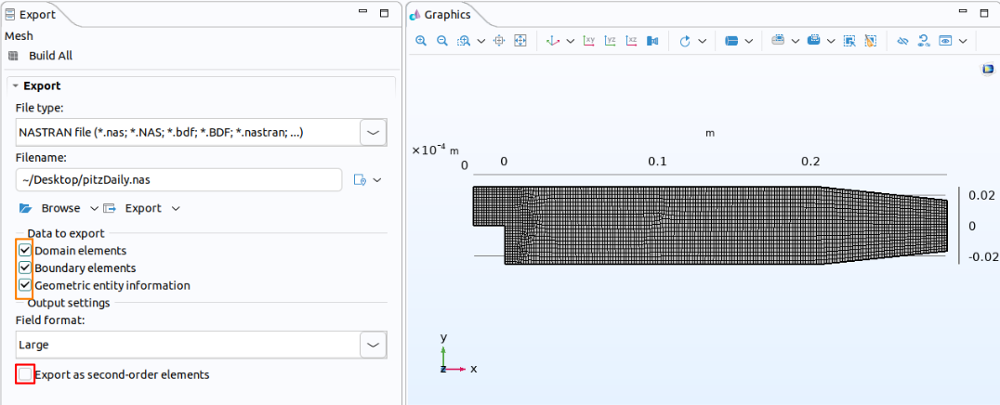
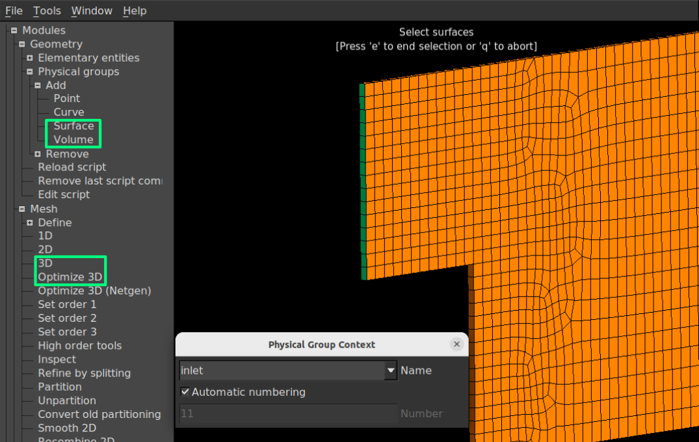

Use COMSOL Multiphysics mesh in OpenFOAM for CFD simulations. This tutorial introduces the export and conversion workflow.




# Motivation

OpenFOAM (OF) offers a flexible framework and a wide range of solvers for computational fluid dynamics (CFD). However, preparing geometry, generating a mesh, and configuring a case can take considerable effort particularly when a study requires repeated geometry changes. On the other hand, COMSOL mutliphysics combines integrated CAD design and mesh generation modules with the mutliphysics solvers. For users already working in COMSOL, this offers a convenient way to modify a CAD geometry and regenerate mesh without maintaining a separate geometry and meshing workflow. Moreover, COMSOL is equipped with an automatic mesh generation engine which can generate quality mesh and facilitates cumbersome process such as face and boundary layer mesh generation. 

In general, a good quality mesh generated by COMSOL is able to pass the <kbd>checkMesh</kbd> requirement by OpenFOAM. Therefore the mesh generated by COMSOL can be used in OpenFOAM solvers. Such capability combined with fast geometry modification can provide COMSOL users access to various dedicated CFD solvers in OpenFOAM and in contrary a fast CAD and mesh modification platform for OpenFOAM users. In any case in the present tutorial aims to provide a method for exporting the mesh generated from COMSOL to OpenFOAM and written assuming that the reader is familiar with OpenFOAM, COMSOL and Gmsh mesh generation workflow.

# Workflow overview

The conversion follows four main steps:

1. **Export the mesh from COMSOL** in Nastran (`.nas`) format, including volume and boundary elements.
2. **Convert the mesh to Gmsh MSH 2.2 format**, using first-order elements and named physical groups.
3. **Import the mesh into OpenFOAM** using `gmshToFoam`.
4. **Check the imported mesh and configure the case**, including boundary patch types and boundary conditions.

Notably, each step in the above mentioned workflow requires attention to a few important details, which are discussed below. Moreover, a successful conversion does not, by itself, guarantee that the mesh is suitable for simulation. Finally, before proceeding, run `checkMesh` and review the imported mesh in `paraview`.

## 1. Exporting the mesh from COMSOL

Once mesh generation is completed in COMSOL, right-click the **Mesh** node and select **Export**. Choose Nastran (`.nas`) as the file type. Figure 1 shows the export settings for the `pitzDaily` tutorial mesh generated in COMSOL.



*Figure 1. COMSOL export settings for the `pitzDaily` mesh, showing the Nastran file type, selected data, and second-order element option.*

In the **Data to export** section, select **domain elements**, **boundary elements**, and **geometric entity information**. This preserves the information needed to identify surfaces and volumes and assign them to physical groups in Gmsh. Finally, uncheck **Export as second-order elements** to export first-order elements for the `gmshToFoam` conversion workflow. Once completed go ahead and export the (`.nas`) file ready for the Gmsh session.


## 2. Converting the mesh to Gmsh

Once the mesh is imported into Gmsh, From **Geometry → Physical groups → Add** select Surface. In the physical group context window name the boundary groups and assign corresponding surfaces to them. The physical-group definitions then are saved in a `.geo` file. Surfaces left unassigned will appear under `defaultFaces` after conversion to OpenFOAM mesh. Repeat the process for the mesh volumes by selecting **Geometry → Physical groups → Add → Volume** and assigning a label to each domain.

Next, under **Mesh → Define**, select **3D** and, if desired, **Optimize 3D**. Finally, go to **File → Export**, select **Mesh – Gmsh MSH** from the drop-down menu, and choose **Version 2 ASCII** in the export window. The resulting `.msh` file can be imported into OpenFOAM using `gmshToFoam`. Figure 2 shows the Gmsh session, with the physical-group and mesh menus highlighted.



*Figure 2. Boundary selection for the `pitzDaily` mesh in Gmsh, the physical-group and mesh menus are highlighted in the sidebar.*


## 3. Converting the mesh to OpenFOAM

The next step is to convert the `.msh` file using `gmshToFoam`. Place the file in the OpenFOAM case directory, which should contain the `system` and `constant` folders, and run:

```bash
gmshToFoam mesh.msh
```

Replace `mesh.msh` with the name of your exported file. The conversion creates the mesh in `constant/polyMesh`. Afterwards, inspect `constant/polyMesh/boundary`: the imported patches may be assigned the generic `patch` type and need to be changed manually where another type, such as `symmetryPlane` or `empty`, is required.

Cyclic boundaries may need additional preparation. In particular, the paired surfaces may require identical meshes in COMSOL, followed by patch configuration in OpenFOAM using `createPatchDict`.
## Prerequisites

This tutorial assumes that you are familiar with:

- Creating geometry and generating meshes in COMSOL.
- The basic structure of an OpenFOAM case.
- Running OpenFOAM utilities from the terminal.

The focus is on transferring the mesh between the two environments, rather than introducing meshing techniques or configuring a complete CFD simulation.